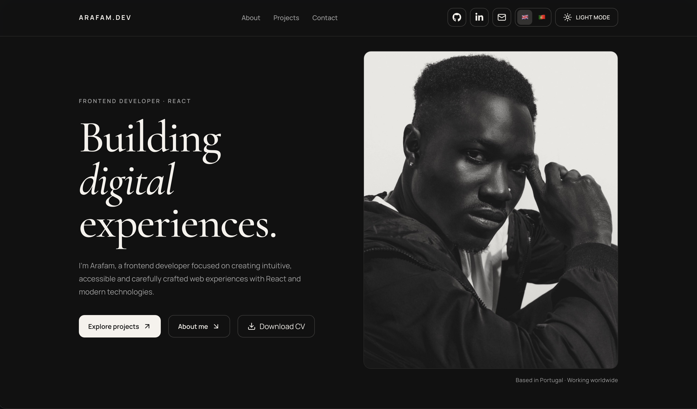
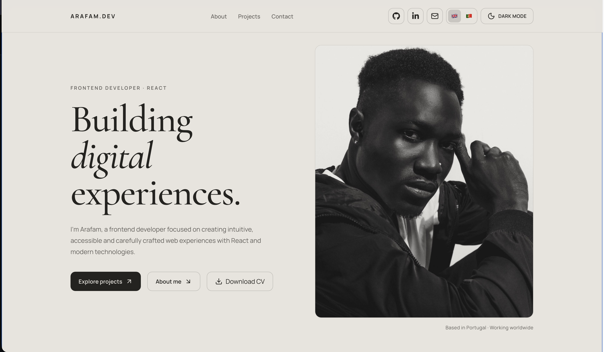
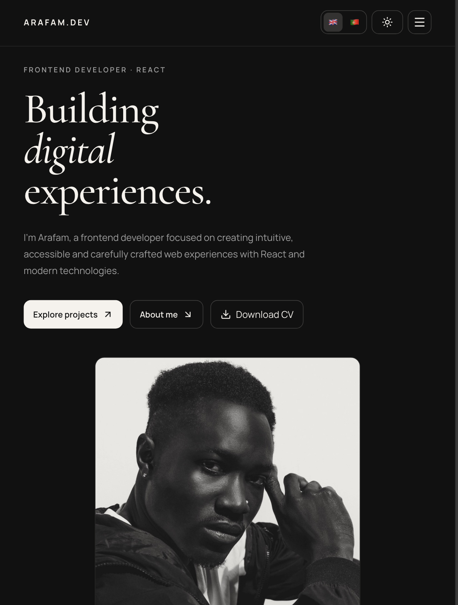
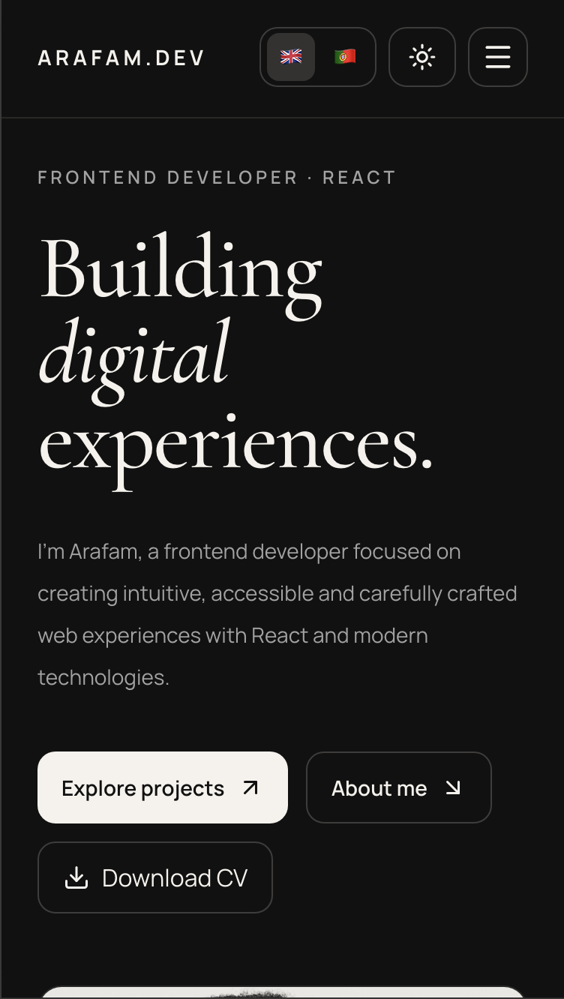

# Arafam.dev — Personal Portfolio

A modern, responsive personal portfolio built with React, designed to showcase my projects, technical skills and approach to frontend development.

The portfolio combines a minimalist editorial design with accessible interactions, bilingual content, persistent theme preferences and performance-focused implementation.

## Live Demo

**[Visit Arafam.dev](https://arafam.dev/)**

## Application Preview

### Desktop · Dark Theme



### Desktop · Light Theme



### Responsive Design

|                          Tablet                           |                          Mobile                           |
| :-------------------------------------------------------: | :-------------------------------------------------------: |
|  |  |

## Features

- **Personal introduction:** Professional profile, technical skills, spoken languages and career background.
- **Project showcase:** Four featured projects with interactive desktop, tablet and mobile previews.
- **Case studies:** Detailed project descriptions, technical decisions and implementation highlights.
- **Project galleries:** Additional application screenshots with localized captions and descriptive alternative text.
- **Theme preferences:** Dark and light themes with persistent user preferences.
- **Internationalization:** Portuguese and English content with persistent language selection.
- **Resume download:** Downloadable CV in Portuguese and English.
- **Professional contact:** Direct access to email, GitHub and LinkedIn.
- **Responsive design:** Adaptive layouts across mobile, tablet and desktop screens.
- **Accessibility:** Semantic HTML, keyboard navigation, visible focus states, accessible dialogs and reduced-motion support.
- **Performance:** Optimized images, lazy loading, critical image preloading and self-hosted fonts.
- **SEO:** Metadata, Open Graph, canonical URL, sitemap and robots.txt.

## Featured Projects

| Project      | Description                                                                                    | Live Demo                                        | Repository                                               |
| ------------ | ---------------------------------------------------------------------------------------------- | ------------------------------------------------ | -------------------------------------------------------- |
| Saturnino    | Local-first project and task management PWA with interactive Kanban boards and offline support | [Live Demo](https://saturnino-app.vercel.app/)   | [GitHub](https://github.com/arafamdev/saturnino)         |
| Djumbai Cine | Movie and TV show discovery application                                                        | [Live Demo](https://djumbai-cine.vercel.app/)    | [GitHub](https://github.com/arafamdev/djumbai-cine)      |
| Atmos        | Weather application with forecasts and location search                                         | [Live Demo](https://atmos-by-arafam.vercel.app/) | [GitHub](https://github.com/arafamdev/atmos-weather-app) |
| DoNext       | Responsive task manager with local persistence                                                 | [Live Demo](https://do-next-app.vercel.app/)     | [GitHub](https://github.com/arafamdev/do-next)           |

## Tech Stack

- **Frontend:** React 19, JavaScript (JSX), Vite 8
- **Styling:** Tailwind CSS v4, CSS custom properties
- **State and storage:** React Hooks, localStorage
- **Icons:** Lucide React, React Icons
- **Typography:** Cormorant Garamond, Manrope
- **Code quality:** ESLint, Prettier
- **Version control:** Git, GitHub
- **Deployment and infrastructure:** Vercel, Cloudflare DNS
- **SEO and auditing:** Google Search Console, Lighthouse, axe DevTools

## Getting Started

Use Node.js 24 or a newer supported release, and npm.

Clone the repository and install dependencies:

```bash
git clone https://github.com/arafamdev/arafam-portfolio.git
cd arafam-portfolio
npm ci
```

Start the development server:

```bash
npm run dev
```

Open the local URL printed by Vite.

No API keys or environment variables are required.

### Production Build

```bash
npm run build
npm run preview
```

The production build is generated in the `dist/` directory.

## Testing and Validation

```bash
npm run format:check
npm run lint
npm run build
git diff --check
```

Use the following command to format project files:

```bash
npm run format
```

Manual validation covers navigation, resume downloads, project previews, case study dialogs, project galleries, theme and language persistence, keyboard interactions and responsive layouts.

Accessibility and performance were evaluated using Lighthouse, axe DevTools, Chrome DevTools and manual browser testing.

## Architecture

The portfolio follows a feature-based architecture with reusable React components and a clear separation of responsibilities.

Portfolio sections are organized within `src/features/portfolio/`, while shared application behavior is handled through reusable hooks and components.

Project metadata is separated from presentation logic, allowing project cards to reuse the same structure while displaying different content, technologies and screenshots.

The project showcase is composed of reusable components:

- `Projects`: Renders the featured project collection.
- `ProjectCard`: Displays project information, interactive device previews and project actions.
- `ProjectCaseStudy`: Presents detailed project information within an accessible native dialog.
- `ProjectGallery`: Displays optional application screenshots with localized captions.
- `TechnologyBadge`: Renders technology labels and their associated icons.
- `projectsData.js`: Defines project metadata, URLs, technologies and image dimensions.

Project descriptions, case study content and gallery captions are maintained separately in Portuguese and English translation files.

Theme and language preferences are managed through React Hooks and persisted using localStorage.

Global styling and semantic design tokens provide visual consistency across dark and light themes.

## Accessibility

Accessibility considerations include:

- Semantic landmarks and heading hierarchy.
- Skip-to-content navigation.
- Visible keyboard focus indicators.
- Accessible mobile navigation and resume controls.
- Native dialogs with keyboard and focus management.
- Descriptive image alternative text.
- Semantic image galleries using figures and captions.
- Accessible names for interactive controls.
- Reduced-motion support.
- Color contrast checks across both themes.

Automated accessibility audits are complemented by manual keyboard and screen reader testing.

## Performance

The portfolio uses several optimization techniques:

- WebP compression for large project screenshots.
- Explicit image dimensions to improve layout stability.
- Lazy loading for project and gallery images.
- Conditional rendering of project galleries when case study dialogs are opened.
- Preloading of the primary Hero image.
- Self-hosted WOFF2 fonts with `font-display: swap`.
- Production asset bundling and minification through Vite.

The Djumbai Cine screenshots were reduced from approximately 5.20 MB to 279 KB, representing a 94.63% reduction in their combined file size.

Saturnino uses seven optimized WebP screenshots for responsive device previews and its application gallery.

These optimizations were implemented without adding npm dependencies.

## Deployment and SEO

The portfolio is deployed on Vercel using a custom domain managed through Cloudflare DNS.

Production deployments are generated from the `main` branch.

SEO configuration includes:

- Page title and description.
- Canonical URL.
- Open Graph and Twitter Card metadata.
- Custom favicon and social sharing image.
- XML sitemap and robots.txt.
- Google Search Console verification.

**Production:** [https://arafam.dev/](https://arafam.dev/)

## Development Workflow

Development follows a structured Git workflow:

1. Create a dedicated feature or maintenance branch.
2. Implement and validate changes locally.
3. Commit changes using descriptive commit messages.
4. Open a pull request for review.
5. Validate the Vercel preview deployment.
6. Integrate approved changes using Squash and merge.
7. Synchronize the local main branch and remove completed branches.

## Author

**Arafam Mussa Silla — Frontend Developer**

[GitHub](https://github.com/arafamdev) · [LinkedIn](https://www.linkedin.com/in/arafam-mussa-silla-5a7866446/) · [Live Portfolio](https://arafam.dev/)
